# AXIS BBS

**A real, old-school telnet BBS, written from scratch in C++.** ANSI art, ZMODEM file areas, messages and email, live multinode chat, a sysop console, Legend of the Red Dragon as a native door, radio dial-in over LoRa, and clusters of boards that run as one BBS.

AXIS started life as firmware for the ESP32 "Cheap Yellow Display". It is growing into a **full native BBS for Linux, with Windows coming soon**, built around the same shared C++ core. The ESP32 boards stay part of the family as the small, compatible build: a standalone pocket BBS, or extra nodes for a bigger board.

The software behind **AXIS UNDERGROUND CNC**. Made by Rev. J. Money, the maker of [RotatoCAM](https://rotatocam.com).

**[Buy me a coffee](https://buymeacoffee.com/revjmoney)** · [Website](https://revjmoney.github.io/axis-bbs/) · [Docs / Wiki](https://revjmoney.github.io/axis-bbs/docs.html) · [Buy a board](https://jmscnc.com/product/axis-underground-bbs-ready-to-plug-in/) · [On jmscnc.com](https://jmscnc.com/axis-bbs/) · [RotatoCAM](https://rotatocam.com) · [jmscnc.com](https://jmscnc.com)

<p align="center">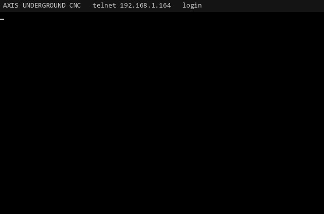</p>

**Want to help?** Bug fixes, features, doors and ANSI art are all welcome: see [CONTRIBUTING.md](CONTRIBUTING.md).

## Where AXIS is going

The ESP32 is a great little BBS, but it is small: 4 MB of flash and no PSRAM. The goal now is a BBS that can grow and be better than the other telnet BBS packages, with an edge nobody else has: retro and radio dial-in (the LFD3K-SM LoRa modem, mesh, and old C64, Amiga and Z80 callers).

- **One shared core.** The BBS itself (menus, screens, messages, files, doors, the sysop commands) is one C++ code base in `src/bbs` and `src/app`. The PC program and the board both build from it.
- **The PC is the main.** On Linux, `axispc` runs many callers in one program. In a cluster the PC is always the main board, and the ESP32 boards join it as nodes.
- **A BBS that looks the way you want.** Every caller-facing screen is moving to theme art plus a menu or list definition, so a look restyles the whole board. Menu sets and art packs from ViSiON/3, Renegade, Iniquity and Oblivion/2 are first, then Mystic, Synchronet and WWIV.
- **The sysop panel lives inside the BBS**, themed and lightbar-driven, on telnet, the window and the WFC.
- **No Python in the product.** C++ throughout (Rust only for small self-contained parts).

### Roadmap

| Project | What it brings | Status |
|---|---|---|
| 1. PC app foundation | `axispc` for Linux: many callers, telnet, radio, the terminal WFC, packages, CI | Done |
| 2. Screen and menu engine | List templates (`.LST`), art dialects (ViSiON/3, Renegade), the in-BBS sysop panel, lightbar doors, menu import, art packs | In progress |
| 3. PC-main cluster | The PC as the cluster's main with ESP32 boards as nodes | Next |
| 4. Retro callers | C64, Amiga and Z80 terminals | Planned |
| 5. Mesh dial-in | Callers over a radio mesh | Planned |
| 6. DOS doors | Unmodified DOS door EXEs on the PC (the `dosemu/` engine) | Planned |
| 7. Windows | A native Windows build and installer | **Coming soon** |
| 8. More architectures | Beyond x86_64, ARM64 and 32-bit ARM | Planned |

## AXIS on Linux

These are from the native Linux build running AXIS UNDERGROUND CNC's own data with our made-up test callers.

<p>
  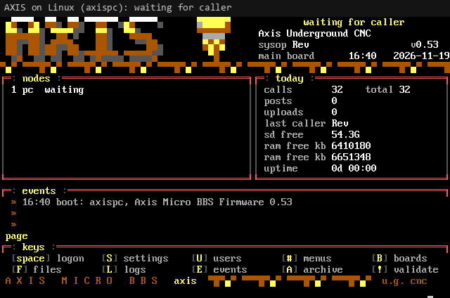
  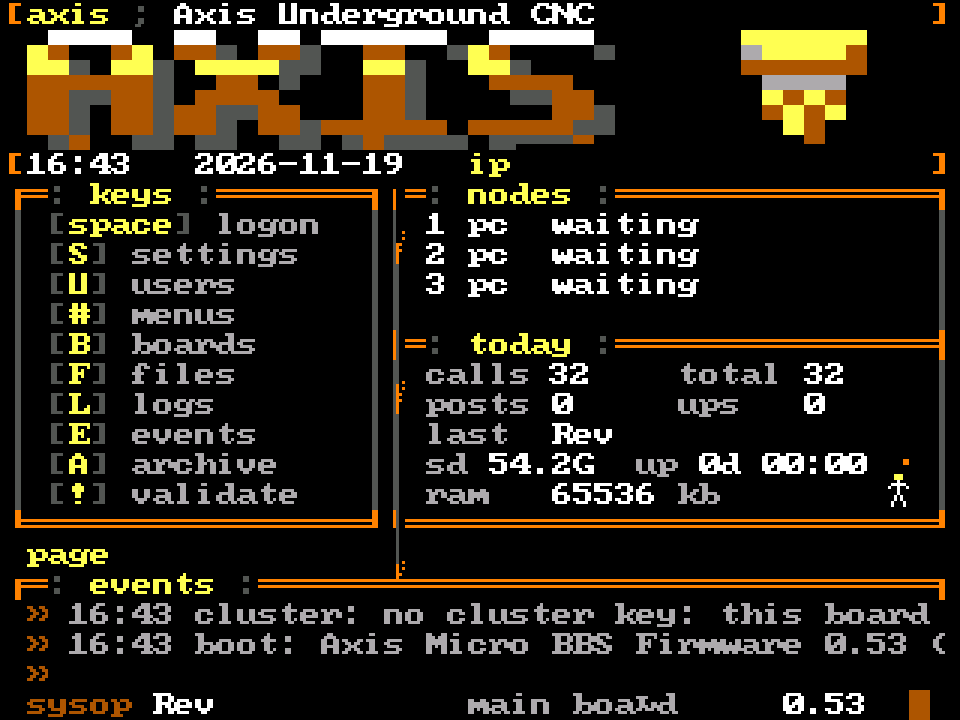
  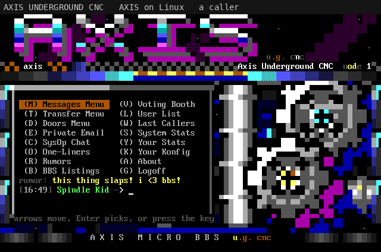
  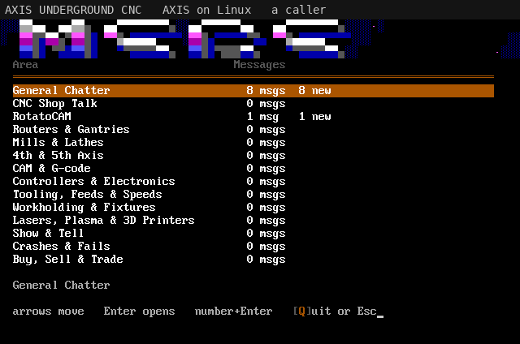
  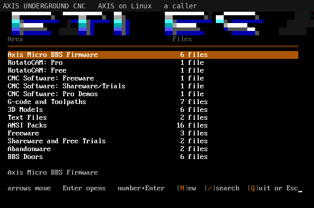
  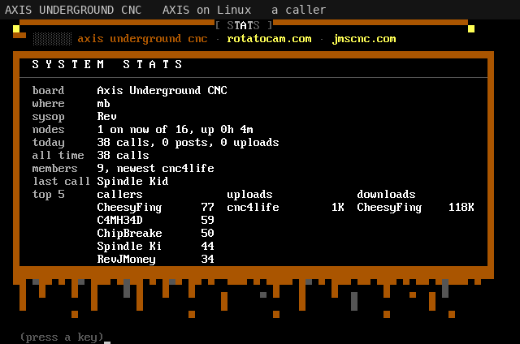
</p>

There are two Linux programs:

- **`axispc`**, the new PC app. It is one program for many callers over telnet and the LFD3K-SM radio modem, with the waiting-for-caller screen in your terminal (`--terminal`) or running as a service (`--headless`).
- **`axis`**, the board's own firmware compiled for Linux. It shows the board's screens in a desktop window (`--window`), in a terminal, or headless, and it can join a cluster of ESP32 boards.

Both keep everything in one data folder (`--data DIR`, default `~/.axis`, or `/var/lib/axis` for the service), with the same layout as a board's SD card and flash.

### Get it

- **Linux packages.** GitHub Actions builds `axispc` and runs the host tests on every change. It makes a **.deb** and an **AppImage** for **x86_64** and **ARM64**, and a .deb for **32-bit ARM** (Raspberry Pi and friends). A `pc-v*` tag publishes them on [GitHub Releases](https://github.com/revjmoney/axis-bbs/releases). **The current Linux release is [axispc pc-v0.54](https://github.com/revjmoney/axis-bbs/releases/tag/pc-v0.54).** Install the .deb with `sudo apt install ./axispc_0.54_amd64.deb` (ARM64: `axispc_0.54_arm64.deb`, 32-bit ARM: `axispc_0.54_armhf.deb`). For the AppImage, `chmod +x axispc-0.54-x86_64.AppImage` (ARM64: `axispc-0.54-aarch64.AppImage`) and run it. You can also build from source (below).
- **As a service.** `installer/linux/install.sh` installs the system service (its own `axis` user, `/var/lib/axis`, the modem's serial group), and `installer/linux/harden-i5.sh` sets up the firewall and fail2ban. See [installer/linux/README.md](installer/linux/README.md).
- **Windows: coming soon.** A native Windows build and installer are on the roadmap (project 7).

### First start

1. Run `axispc --terminal` (or start the service).
2. The terminal shows a setup PIN. Telnet to the computer on the LAN port (2323 by default), type the PIN, and answer the setup wizard.
3. Call in with [SyncTERM](https://syncterm.bbsdev.net/) (80x25, CP437) and log in as the sysop.

Ports and limits live in `axis.conf` in the data folder: `lan_port` (2323), `public_port` (0, off), `max_callers` (16), `max_per_ip` (3, 8 on the LAN) and `rate_per_ip`, with a ban for a caller who goes past it. Set `modem=/dev/ttyUSB0` for the radio modem.

## The ESP32 board build

The ESP32 build is **Axis Micro BBS Firmware**: the same BBS on the "Cheap Yellow Display" (CYD, ESP32-2432S028R: 2.8" 320x240 touchscreen, 4 MB flash, no PSRAM). The little board is the whole BBS, or a node of a bigger one. It keeps getting the shared core's features that fit under its flash line.

### The cluster family

<p align="center">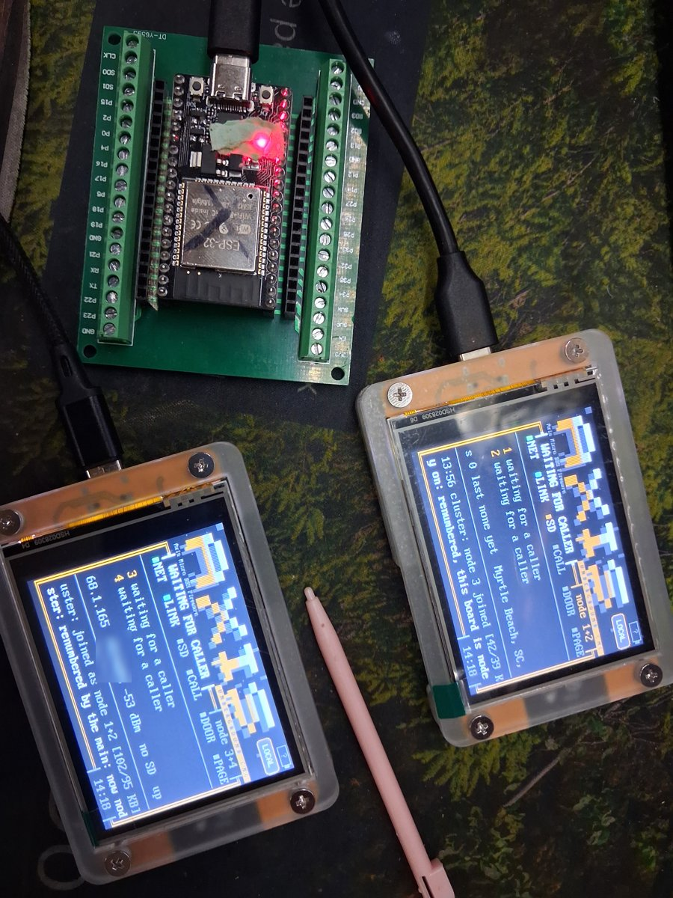</p>

Our test cluster: board 1 (SD card, nodes 1+2), board 2 (nodes 3+4) and a headless ESP32 on a breakout (nodes 5 to 7). Seven nodes, one BBS. The Linux build joins the same cluster.

### Get one

<a href="https://jmscnc.com/product/axis-underground-bbs-ready-to-plug-in/">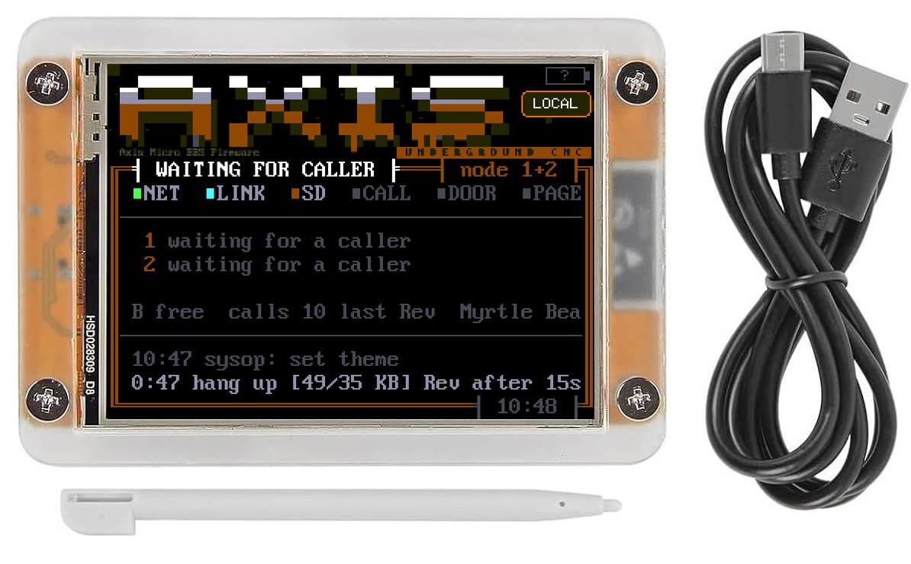</a>

**[Ready to plug in: $79.00 + $9.00 shipping (US)](https://jmscnc.com/product/axis-underground-bbs-ready-to-plug-in/)**. The board in a clear acrylic case with the firmware installed and tested, a touch stylus and a USB cable. You supply USB power and 2.4 GHz WiFi. **microSD card not included:** add your own (FAT32) to turn on the file areas. The [web installer](https://revjmoney.github.io/axis-bbs/install.html) flashes the latest board release from your browser.

**Our test board, AXIS UNDERGROUND CNC, is up and running.** Request access for private testing: [email Rev](mailto:therealrevjmoney@gmail.com?subject=AXIS%20UNDERGROUND%20CNC%20private%20test%20access&body=Hi%20Rev%2C%20I%27d%20like%20to%20call%20the%20AXIS%20UNDERGROUND%20CNC%20test%20board.%0A%0AHandle%20I%27d%20like%3A%0AWhat%20I%27ll%20call%20in%20with%20(SyncTERM%2C%20NetRunner%20...)%3A%0A) (therealrevjmoney@gmail.com, subject "AXIS private test access") or ask on [Discord](https://discord.gg/23KqHWM6vd).

### Features

| Feature | What you get | Docs |
|---|---|---|
| Looks | Drippy orange Axis, an Oblivion/2 style with a lightbar front door, green and grey Iniquity, and the card screensets; your own ANSI screens with pipe and MCI codes; list screens restyled by a look's `.LST` files ([art and menus](docs/MENU-ART.md)) | [themes](https://revjmoney.github.io/axis-bbs/docs.html#themes) |
| File areas | FILES.BBS areas on SD, archive listings (ZIP, RAR, RAR 5, ARJ, TAR, GZIP), search, new files | [files](https://revjmoney.github.io/axis-bbs/docs.html#files) |
| Transfers | ZMODEM, XMODEM, XMODEM-1K both ways; ZIP uploads CRC-checked; download gate and ratio | [transfers](https://revjmoney.github.io/axis-bbs/docs.html#transfers) |
| Messages | Areas, quoted replies, taglines, new scan, private email | [messages](https://revjmoney.github.io/axis-bbs/docs.html#messages) |
| Community | Oneliners, rumors, BBS list, top ten, voting booth, last callers, system and your stats | [community](https://revjmoney.github.io/axis-bbs/docs.html#community) |
| Multinode | Up to 4 callers per board; more boards join as nodes of one BBS with failover; boards link only with a shared cluster key (`@CLUSTERKEY`) | [multinode](https://revjmoney.github.io/axis-bbs/docs.html#cluster-key) |
| Nets | Sysop Net and User Net between boards, with signed records, voting on new boards and Net Files ([NETS.md](docs/NETS.md)) | [nets](docs/NETS.md) |
| SD card clustering | Every card in the cluster as one library, with mirrored areas (built, PC tested). **Work in progress:** the SD disc changer, each card a hot-swappable disc with FILE_ID.DIZ descriptions | [sd-pool](https://revjmoney.github.io/axis-bbs/docs.html#sd-pool) |
| Radio dial-in | Callers over the LRA FLOWTRON DATAMASTER 3000 SERIAL MODEM (LFD3K-SM) LoRa modem, with light screens for slow radio tiers | [radio](https://revjmoney.github.io/axis-bbs/docs.html#radio) |
| Chat | Teleconference, node messages, broadcasts, split-screen chat | [chat](https://revjmoney.github.io/axis-bbs/docs.html#chat) |
| Native LORD | Legend of the Red Dragon in C++, on the board, over telnet. Several callers can play at once. Art and warriors come from the installed LORD folder. | [lord](https://revjmoney.github.io/axis-bbs/docs.html#lord) |
| DOS emulator | A separate PC build (`dosemu/`, `doorhost`) for an unmodified EXE such as LORD.EXE or BBS Black Jack. It is not linked into the ESP32 image. | [dosemu](https://revjmoney.github.io/axis-bbs/docs.html#dosemu) |
| Built-in doors | ANSI Pack Viewer with ANSI movies; password-locked DOS prompt | [ansi-viewer](https://revjmoney.github.io/axis-bbs/docs.html#ansi-viewer) |
| Accounts | New user application, validation, levels, permissions, time limits, twit flag | [accounts](https://revjmoney.github.io/axis-bbs/docs.html#accounts) |
| Sysop console | A Renegade-style waiting-for-caller screen in every look (80x25 over telnet and serial, 45x24 on the touchscreen; [art codes](docs/WFC-CODES.md)), one layered sysop menu inside the BBS (users, file areas and files, message bases and posts, every setting, a menu editor, system) on telnet and the touchscreen, `//` keys for sysops online, local console | [cyd-console](https://revjmoney.github.io/axis-bbs/docs.html#cyd-console) |
| Headless nodes | Plain ESP32 boards as extra nodes, set up over the AXIS-SETUP hotspot | [headless](https://revjmoney.github.io/axis-bbs/docs.html#headless) |
| Sysop control panel | A PC app that serves a panel to your phone or PC on the LAN: every control, a live wall of every node's screen, console login or break-in | [control-panel](https://revjmoney.github.io/axis-bbs/docs.html#control-panel) |
| Internet extras | No-IP dynamic DNS (asked by the setup wizard), GoDaddy DNS, Discord announcements | [internet](https://revjmoney.github.io/axis-bbs/docs.html#internet) |

<p>
  <a href="https://revjmoney.github.io/axis-bbs/docs.html#themes">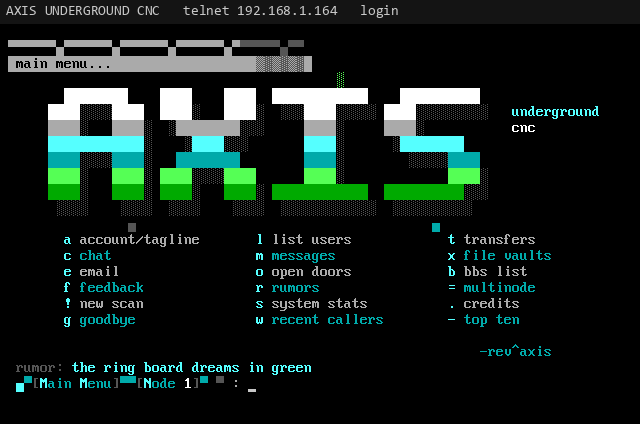</a>
  <a href="https://revjmoney.github.io/axis-bbs/docs.html#files">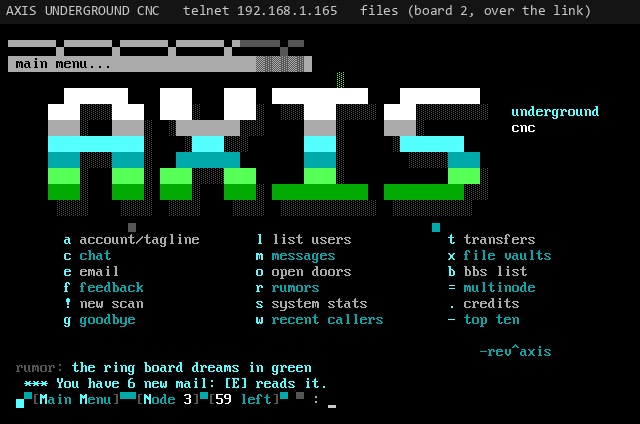</a>
  <a href="https://revjmoney.github.io/axis-bbs/docs.html#chat">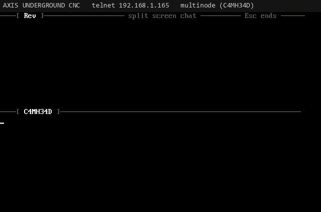</a>
  <a href="https://revjmoney.github.io/axis-bbs/docs.html#lord">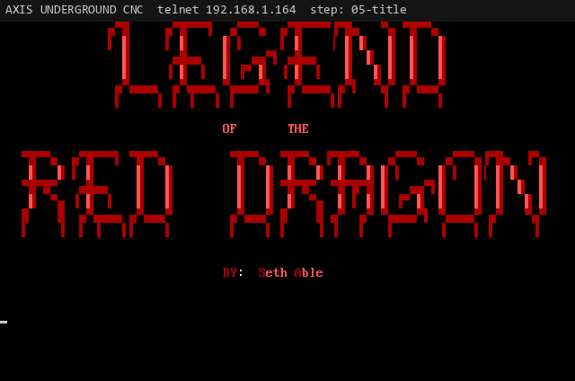</a>
  <a href="https://revjmoney.github.io/axis-bbs/docs.html#cyd-console">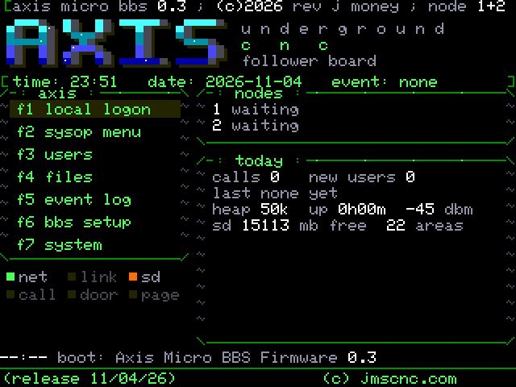</a>
  <a href="https://revjmoney.github.io/axis-bbs/docs.html#local-console">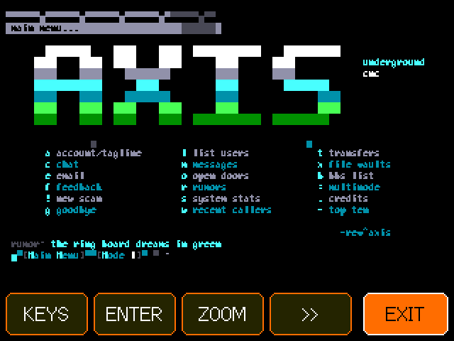</a>
</p>

### Quick start (board)

1. **Flash** (skip if you bought one): use the [web installer](https://revjmoney.github.io/axis-bbs/install.html), or install [PlatformIO](https://platformio.org/), then

   ```
   git clone https://github.com/revjmoney/axis-bbs.git
   cd axis-bbs
   pio run -e cyd -t upload --upload-port COM5
   (The firmware builds on ESP-IDF with Arduino as a component; the first build downloads ESP-IDF.)
   ```

2. **WiFi:** pick your 2.4 GHz network on the touch picker.
3. **Setup:** tap **OVER TELNET**, call `axis.local` from a computer on the same network, type the 6-digit PIN, answer the wizard.
4. **Call in** with [SyncTERM](https://syncterm.bbsdev.net/) (80x25, CP437) and log in as the sysop.
5. **More than one board?** Boards only cluster when they share a secret. On the USB serial console of each board type `@CLUSTERKEY <secret>` (8 or more characters, the same on every board). It stays in that board's own storage and is never shown or synced. Without a key a board runs alone. Flash every board with the same firmware together.

Settings are changed on the board (BBS SETUP), over the USB serial console at 115200 baud with `@SET key=value`, or in `/axis.ini`; the main board shares them with every board. See [first-boot setup](https://revjmoney.github.io/axis-bbs/docs.html#first-setup), [calling in and port forwarding](https://revjmoney.github.io/axis-bbs/docs.html#calling-in), the [settings reference](https://revjmoney.github.io/axis-bbs/docs.html#settings) and the [serial console](https://revjmoney.github.io/axis-bbs/docs.html#serial).

## Building and tests

The tree builds two ways. `CMakeLists.txt` picks from whether `IDF_PATH` is set.

- **The PC build (Linux).** A plain CMake run, with `IDF_PATH` unset, includes `CMakeLists.pc.txt`. It builds `axispc`, the host tests (`axis_tests`, which cover the shared core, the PC app and the board code), `dosemu/` and `doorhost` (for unmodified DOS EXEs). The `axis` program (the board's firmware on Linux) is built too when you point it at LovyanGFX (`-DLOVYANGFX_DIR=.pio/libdeps/cyd/LovyanGFX`), with its window when the SDL2 dev files are installed.

  ```
  cmake -S . -B build -G Ninja && cmake --build build && build/axis_tests
  build/axispc --terminal --data ~/.axis
  ```

  `cpack -G DEB` in the build folder makes the .deb. The CI recipe for the AppImage and the 32-bit ARM cross build is in [.github/workflows/pc.yml](.github/workflows/pc.yml).
- **The board.** PlatformIO sets `IDF_PATH`, so this is the ESP32 image: `pio run -e cyd` (also `headless` and `headless-ring`, and `cyd-bench` for the bench tools). Native LORD is `src/lord/` and is in that image. `dosemu/` is not linked. An `.EXE` door tells the caller the DOS runtime is not in this firmware. Partitions in `partitions.csv`: app 2.25 MB, LittleFS 1.69 MB. The board image has a flash line of 2,200,000 B that every change is measured against.

CI on GitHub: the board images and host tests (`build.yml`), the PC packages (`pc.yml`), board releases from `v*` tags (`release.yml`), sanitizers, cppcheck, CodeQL and Fortify scans, and the website (`pages.yml`).

More: [hardware and building](https://revjmoney.github.io/axis-bbs/docs.html#hardware), [features and settings log](docs/FEATURES.md), [art, menus and list templates](docs/MENU-ART.md), [designs and plans](docs/superpowers/), [profiling tools](tools/profiling/) (LORD memory profile on a PC). The website source is in [`site/`](site/).

## Credits

AXIS BBS, Axis Micro BBS Firmware and the AXIS UNDERGROUND CNC board are created by **Rev. J. Money**: [rotatocam.com](https://rotatocam.com) and [jmscnc.com](https://jmscnc.com).

If AXIS makes you smile, [buy me a coffee](https://buymeacoffee.com/revjmoney).

## License

Copyright (C) 2026 Rev. J. Money.

This project is free software under the **GNU General Public License v3.0 or later** (see `LICENSE`). You can use, study, change and share it, but anything you distribute that is built from it must also be GPL-3.0 with its source available, and you must keep the copyright notices.

**Additional term under GPLv3 section 7(b):** any copy or derived work, in whole or in part, must keep the "Copyright (C) 2026 Rev. J. Money" notices in the source files, must keep the author credit (Rev. J. Money, rotatocam.com, jmscnc.com) in this README or an equivalent file, and, if it has an interactive interface, must keep that credit visible in its credits or about screen.

Third-party pieces keep their own licenses and are listed in `THIRD_PARTY_NOTICES.md` as they are added.
