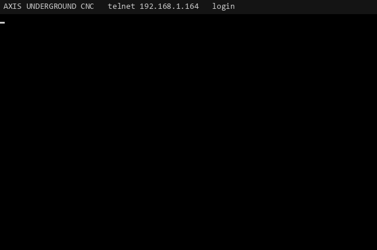
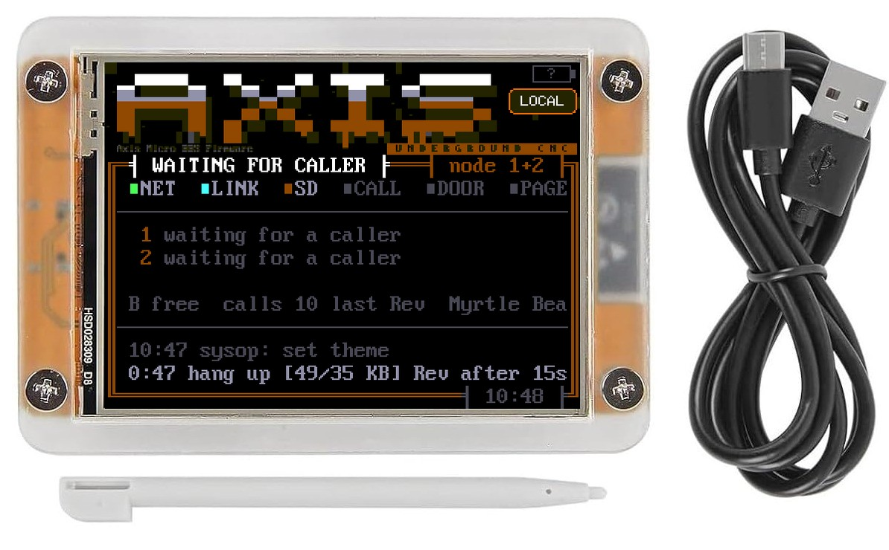
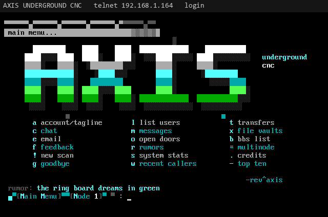
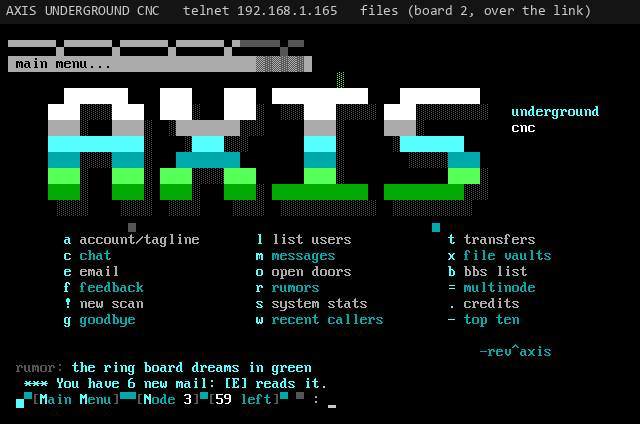
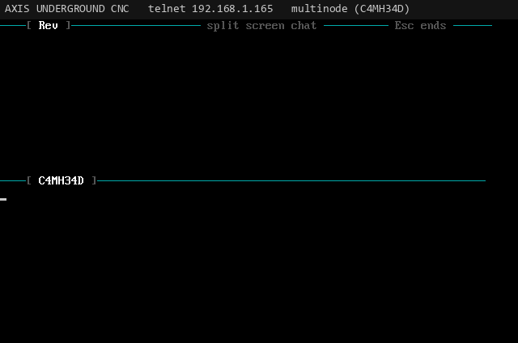
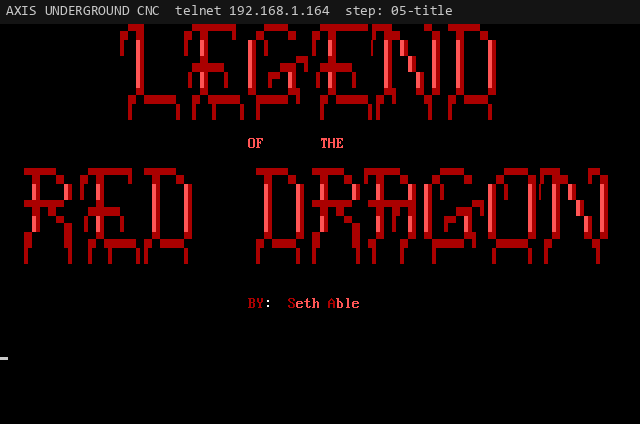
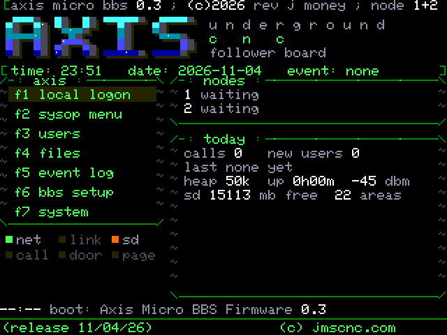
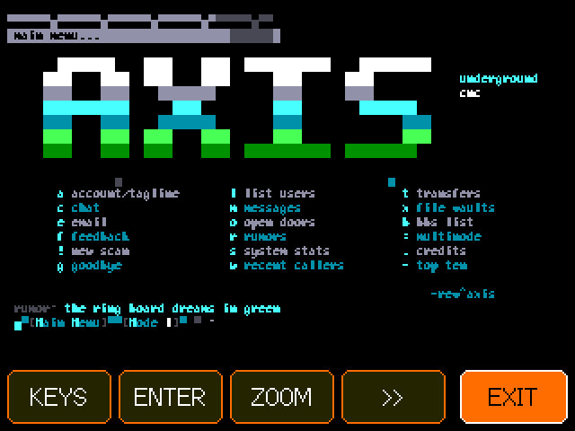

# Axis Micro BBS Firmware

**A real, old-school telnet BBS written from scratch in C++ for the ESP32 "Cheap Yellow Display"** (CYD, ESP32-2432S028R: 2.8" 320x240 touchscreen, 4 MB flash, no PSRAM). ANSI art, ZMODEM file areas, messages and email, live multinode chat, a touch sysop console, and real DOS doors like Legend of the Red Dragon on a built-in 8086 emulator. The little board is the whole BBS.

The software behind **AXIS UNDERGROUND CNC**. Made by Rev. J. Money, the maker of [RotatoCAM](https://rotatocam.com).

[Website](https://revjmoney.github.io/axis-bbs/) · [Docs / Wiki](https://revjmoney.github.io/axis-bbs/docs.html) · [Buy one](https://jmscnc.com/product/axis-underground-bbs-ready-to-plug-in/) · [On jmscnc.com](https://jmscnc.com/axis-bbs/) · [RotatoCAM](https://rotatocam.com) · [jmscnc.com](https://jmscnc.com)

<p align="center"></p>

## Get one

<a href="https://jmscnc.com/product/axis-underground-bbs-ready-to-plug-in/"></a>

**[Ready to plug in: $79.00 + $9.00 shipping (US)](https://jmscnc.com/product/axis-underground-bbs-ready-to-plug-in/)**. The board in a clear acrylic case with the firmware installed and tested, a touch stylus and a USB cable. You supply USB power and 2.4 GHz WiFi. **microSD card not included:** add your own (FAT32) to turn on the file areas.

**Our test board, AXIS UNDERGROUND CNC, is up and running.** Request access for private testing: [email Rev](mailto:therealrevjmoney@gmail.com?subject=AXIS%20UNDERGROUND%20CNC%20private%20test%20access&body=Hi%20Rev%2C%20I%27d%20like%20to%20call%20the%20AXIS%20UNDERGROUND%20CNC%20test%20board.%0A%0AHandle%20I%27d%20like%3A%0AWhat%20I%27ll%20call%20in%20with%20(SyncTERM%2C%20NetRunner%20...)%3A%0A) (therealrevjmoney@gmail.com, subject "AXIS private test access") or ask on [Discord](https://discord.gg/23KqHWM6vd).

## Features

| Feature | What you get | Docs |
|---|---|---|
| Two looks | Drippy orange Axis, or an Oblivion/2 style with a lightbar front door; your own ANSI screens with pipe and MCI codes | [themes](https://revjmoney.github.io/axis-bbs/docs.html#themes) |
| File areas | FILES.BBS areas on SD, archive listings (ZIP, RAR, RAR 5, ARJ, TAR, GZIP), search, new files | [files](https://revjmoney.github.io/axis-bbs/docs.html#files) |
| Transfers | ZMODEM, XMODEM, XMODEM-1K both ways; ZIP uploads CRC-checked; download gate and ratio | [transfers](https://revjmoney.github.io/axis-bbs/docs.html#transfers) |
| Messages | Areas, quoted replies, taglines, new scan, private email | [messages](https://revjmoney.github.io/axis-bbs/docs.html#messages) |
| Community | Oneliners, rumors, BBS list, top ten, voting booth, last callers | [community](https://revjmoney.github.io/axis-bbs/docs.html#community) |
| Multinode | Up to 4 callers per board; more boards join as nodes of one BBS with failover | [multinode](https://revjmoney.github.io/axis-bbs/docs.html#multinode) |
| SD card clustering | Every card in the cluster as one library, with mirrored areas (built, PC tested). **Work in progress:** the SD disc changer, each card a hot-swappable disc with FILE_ID.DIZ descriptions | [sd-pool](https://revjmoney.github.io/axis-bbs/docs.html#sd-pool) |
| Chat | Teleconference, node messages, broadcasts, split-screen chat | [chat](https://revjmoney.github.io/axis-bbs/docs.html#chat) |
| DOS doors | 8086 emulator with FOSSIL and DOOR.SYS: LORD 4.07, BBS Black Jack | [lord](https://revjmoney.github.io/axis-bbs/docs.html#lord) |
| Built-in doors | ANSI Pack Viewer with ANSI movies; password-locked DOS prompt | [ansi-viewer](https://revjmoney.github.io/axis-bbs/docs.html#ansi-viewer) |
| Accounts | New user application, validation, levels, permissions, time limits, twit flag | [accounts](https://revjmoney.github.io/axis-bbs/docs.html#accounts) |
| Sysop console | Activity screen with status lights, KICK, touch sysop menu, local console | [cyd-console](https://revjmoney.github.io/axis-bbs/docs.html#cyd-console) |
| Headless nodes | Plain ESP32 boards as extra nodes, set up over the AXIS-SETUP hotspot | [headless](https://revjmoney.github.io/axis-bbs/docs.html#headless) |
| Internet extras | No-IP dynamic DNS (asked by the setup wizard), GoDaddy DNS, Discord announcements | [internet](https://revjmoney.github.io/axis-bbs/docs.html#internet) |

<p>
  <a href="https://revjmoney.github.io/axis-bbs/docs.html#themes"></a>
  <a href="https://revjmoney.github.io/axis-bbs/docs.html#files"></a>
  <a href="https://revjmoney.github.io/axis-bbs/docs.html#chat"></a>
  <a href="https://revjmoney.github.io/axis-bbs/docs.html#lord"></a>
  <a href="https://revjmoney.github.io/axis-bbs/docs.html#cyd-console"></a>
  <a href="https://revjmoney.github.io/axis-bbs/docs.html#local-console"></a>
</p>

## Quick start

1. **Flash** (skip if you bought one): install [PlatformIO](https://platformio.org/), then

   ```
   git clone https://github.com/revjmoney/axis-bbs.git
   cd axis-bbs
   pio run -e cyd -t upload --upload-port COM5
   ```

2. **WiFi:** pick your 2.4 GHz network on the touch picker.
3. **Setup:** tap **OVER TELNET**, call `axis.local` from a computer on the same network, type the 6-digit PIN, answer the wizard.
4. **Call in** with [SyncTERM](https://syncterm.bbsdev.net/) (80x25, CP437) and log in as the sysop.

Settings are changed on the board (BBS SETUP), over the USB serial console at 115200 baud with `@SET key=value`, or in `/axis.ini`; the main board shares them with every board. See [first-boot setup](https://revjmoney.github.io/axis-bbs/docs.html#first-setup), [calling in and port forwarding](https://revjmoney.github.io/axis-bbs/docs.html#calling-in), the [settings reference](https://revjmoney.github.io/axis-bbs/docs.html#settings) and the [serial console](https://revjmoney.github.io/axis-bbs/docs.html#serial).

## Building and tests

- Firmware: PlatformIO, `espressif32@6.9.0`, Arduino, LovyanGFX. Environments `cyd` (default), `headless`, `headless-ring` (`platformio.ini`). Partitions in `partitions.csv`: app 1.81 MB, door 448 KB, LittleFS 1.69 MB (kept in place, so users and settings survive a flash).
- PC tests of the portable code and the 8086 door runtime (CMake, Ninja, g++ from MSYS2 on Windows, doctest):

  ```
  cmake -S . -B build -G Ninja && cmake --build build && build/axis_tests
  ```

More: [hardware and building](https://revjmoney.github.io/axis-bbs/docs.html#hardware), [features and settings log](docs/FEATURES.md), [design](docs/superpowers/specs/2026-11-02-axis-underground-bbs-v1-design.md), [profiling tools](tools/profiling/) (LORD memory profile on a PC). The website source is in [`site/`](site/).

## Credits

Axis Micro BBS Firmware and the AXIS UNDERGROUND CNC board are created by **Rev. J. Money**: [rotatocam.com](https://rotatocam.com) and [jmscnc.com](https://jmscnc.com).

## License

Copyright (C) 2026 Rev. J. Money.

This project is free software under the **GNU General Public License v3.0 or later** (see `LICENSE`). You can use, study, change and share it, but anything you distribute that is built from it must also be GPL-3.0 with its source available, and you must keep the copyright notices.

**Additional term under GPLv3 section 7(b):** any copy or derived work, in whole or in part, must keep the "Copyright (C) 2026 Rev. J. Money" notices in the source files, must keep the author credit (Rev. J. Money, rotatocam.com, jmscnc.com) in this README or an equivalent file, and, if it has an interactive interface, must keep that credit visible in its credits or about screen.

Third-party pieces keep their own licenses and are listed in `THIRD_PARTY_NOTICES.md` as they are added.
